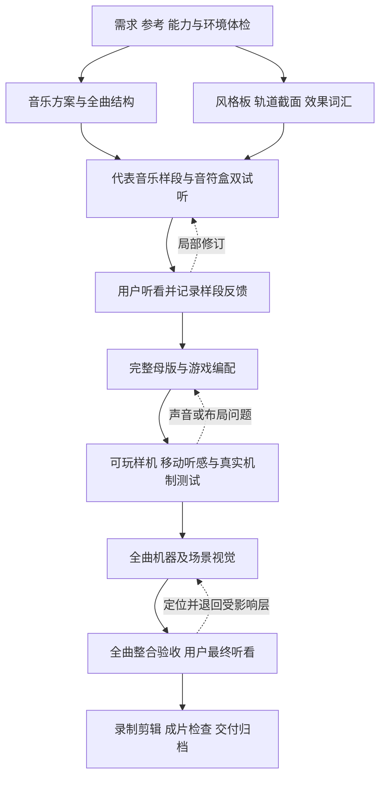

# 红石音乐制作集成包：正式改写方案

设计基线：2026-11-17。当前公开软件为v0.1；本文确定下一版产品结构、集成取舍和实施验收。本文中的新Skill、合同、目录和接口是待实现设计，不是现有命令说明。当前运行仍按[PIPELINE.md](../PIPELINE.md)。

配套依据：[Nevada正式复盘](NEVADA_RETROSPECTIVE.md)、[工具研究](TOOLING_RESEARCH.md)、[Minecraft领域研究](MINECRAFT_DOMAIN_SKILLS.md)。

## 1. 对用户目的的理解

交付一套**可供具备基本能力的新agent从零接手的红石音乐制作工作包**。新agent只拿到公共包、作品需求和必要素材，就能理解方法、准备环境、提出创作方案、调用工具、诊断失败、请求必要反馈、制作完整演出并交付。

工作包同时提供：

- 专业方法与Skill：为什么这样做，怎样选择、修订和换路线。
- 可执行工具：精确操作、专业分析、预览、构建和验证。
- 领域知识与原创案例：关键机制、有效经验、失败样例和修复示范。
- 项目合同与状态：输入、目标、决策、任务、版本、反馈和证据。
- 可复现环境：目标版本、依赖安装/导入、能力探测、锁与隔离实例。
- 清晰交付：可玩世界、投影、声音/视觉配套、操作说明、录制与成片证据。

用户已明确默认协作：**agent自主推进，在代表样段和最终成品时请用户听看。** 日常执行、技术修复和常规研究不变成逐步请示。涉及方向或质量的重要缺失信息应尽早询问，同时继续独立工作。

agent负责理解与创作，工具负责可靠执行与测量。主agent可委派专业角色，也可在不支持子agent的宿主中按相同合同顺序完成；不强制多模型、云API或某一家平台。

## 2. 第一版集成包的范围

目标链路：作品需求/参考→素材体检→音乐母版→音符盒编配与专用声音→实体样机→全曲机器→轨道/场景与音乐视觉→完整演出→录制/剪辑交付与成片检查。

默认以实体红石驱动音符盒，数据包控制、客户端负责必要视觉。字幕、独立背景建筑和复杂后期按作品合同启用；发布材料可以生成，外部投稿另按用户指令执行。

支持三种真实起点：可信MIDI、带参考的待改编MIDI、只有参考音频/分轨。第三种由音乐Skill选择转写/校对路线；不承诺“任意录音自动精确扒成完整多轨”。未具备的素材或能力必须可定位，并有替代路线。

完整包允许依赖操作者合法提供的Minecraft和素材，要求安装/导入步骤自包含。源码ZIP与运行环境缓存分开，不能把原曲、游戏二进制或本机`.runtime`打入公共源码。

本次只制定改写方案与正式复盘，不开始生产引擎改写、安装外部Skill或替换作品。

## 3. 新大纲：六层组成

| 层 | 负责的问题 | 主要内容 |
|---|---|---|
| 入口与启动 | 新agent如何知道先做什么 | 单一START_HERE、能力探测、初始化与学习样例入口 |
| 专业技能 | agent如何判断和创作 | 8个项目Skill、按需教程、问题诊断、方案比较与退出条件 |
| 领域工具 | 哪些工作有现成可靠执行器 | 音乐分析/编辑、双试听、声音包、体素预览、演出编排、录制检查 |
| 构建与验证内核 | 怎样变成可靠游戏工程 | 保留v0.1缓存/锁/恢复/IR/导出/实测能力，参数化布局与运行环境 |
| 项目与证据 | 如何分工、交接和防止假完成 | 版本合同、任务/结果、决策、样段反馈、证据和交付清单 |
| 环境与扩展 | 如何换机器、宿主与后端 | 固定基础profile、可选依赖、后端能力表、通用CLI/JSON及MCP薄包装 |

计划的仓库结构：

```text
START_HERE.md                 冷启动入口
AGENTS.md                     简短工作约定，指向入口与当前能力
skills/                       8个项目Skill，正文短、细节按需读取
redstone_music/               保留并改造的执行/编译/验证核心
integrations/                 已选外部工具的窄适配层
client/                       标准Loom/Gradle的Fabric源码工程
schemas/                      任务、音乐、声音、场景、演出与证据合同
profiles/                     环境/布局/声音/画面profile与锁文件
examples/                     可公开的原创学习案例与失败案例
templates/                    作品需求、项目计划、决策、听看反馈模板
docs/                         架构、教程索引、故障、环境、维护与案例复盘
tests/                        合同、机制、集成与冷启动评测
projects/                     用户作品，默认不进入源码仓库
```

不为每个Skill复制一套脚本。公共工具与schema只有一份；Skill描述何时用、怎样解释结果。宿主专用发现文件由适配器生成，标准Markdown/CLI能力保持独立。

## 4. 制作流程与决策位置



艺术方向由agent提出候选并说明依据；结构错误、共享槽冲突、时序等由工具给出证据。样段应覆盖不同风险，可组合在一次用户评审中，不要求每一条音轨单独征求批准。

风格/光影兼容和关键音色在早期小样检查，不等全曲搭完再发现问题。音色、布局与移动听感允许往返；阶段图描述组织方式，确定性构建DAG仍只管理文件依赖，不能代替创作决策。

默认每个创作问题先比较少量候选、最多两轮修订；同因技术失败两次后整理最小复现并换方法。预算可配置，达到阈值时保留候选与证据，主agent决定下一条有理由的路线；不无限重试，也不伪称完成。

## 5. 自主开发的8个专业Skill

| Skill（拟定名） | 决策职责 | 必须交付/调用 | 失败返回 |
|---|---|---|---|
| `redstone-producer` | 理解作品、计划、能力路由、预算、分工和反馈整合 | 作品合同、阶段计划、任务/决策、版本与下一操作 | 补缺失输入、调整路线或缩小实验 |
| `music-director` | 素材辨认、转写校对、曲式、配器、段落发展与母版修订 | 全曲结构/角色、MIDI、局部patch、GM试听、来源说明 | 转写/乐理分析、局部重编 |
| `noteblock-arranger` | 乐句音色连续性、音域、持续音、力度近似、空间声部关系 | adaptation plan、声音profile选择、事件变换与双试听 | 音色/织体/布局或母版修订 |
| `sound-designer` | 选音/合成、样本中心音、包络、分槽与相对混音 | 样本manifest、校准、声音包、独奏/混合比较 | 重新选样、路由与持续策略 |
| `redstone-engineer` | 实体时序、容量、加载、相机、启停与复位 | 布局/电路profile、世界/投影/控制包、真实事件证据 | 模块与运行环境诊断 |
| `stage-designer` | 轨道外形、结构模块、材质、固定照明与相机视线 | 风格板、模块蓝图、保护区检查、多视角预览 | 修改比例/材质/布局，拒绝冲突模块 |
| `show-director` | ColorBlock类效果语言、乐句演出、镜头关系和字幕 | 效果库、show score、样段录制、性能和清理 | 局部构图/运动/后端调整 |
| `verify-and-deliver` | 技术/客户端/艺术证据核对、录制、安装、成片与交付 | 证据矩阵、实录、验收范围、release manifest和手册 | 按证据定位层，生成明确修复任务 |

8个Skill不要求8个agent同时运行。单agent可顺序承担，多agent按任务目录隔离。真实文件校验与事件追踪由独立程序完成；用户听看是艺术反馈，不能用同一个模型自评分代替。

每个Skill具备：短入口、相关原理/教程、工具schema与实例、一个原创成功案例、一个故意失败案例、常见问题的诊断路线、可检查退出条件。使用skill-creator的渐进披露方式，默认只加载入口和当前环节，不把全部教程塞入上下文。

Minecraft通用开发/资源包/数据包/测试Skill作为基础参考，项目自己的Skill集中在红石音乐判断与产物，不重复编写完整Fabric百科。

## 6. 外部项目的集成决定

### 首批实现并承担标准能力

| 项目 | 决定采用的部分 | 接入与验收 |
|---|---|---|
| [music21](https://github.com/cuthbertLab/music21) | 乐理与声部只读分析；BSD-3-Clause | Python适配，固定发行版；不默认用它往返重写母版，保护原始tempo/控制事件 |
| [Mido](https://github.com/mido/mido) | MIDI事件级编辑辅助；MIT | 保留严格导入器，新增局部patch与变更检查；只改指定声部/范围 |
| [TinySoundFont Python](https://pypi.org/project/tinysoundfont/0.3.7/) | 离线GM试听；MIT引擎 | 全曲/独奏/分组与尾音，测试tempo、踏板、program及支持边界 |
| MuseScore General SoundFont | 标准GM试听音源 | [官方资料](https://musescore.org/en/handbook/3/soundfonts-and-sfz-files)列MIT；按需取SF2并保存具体文件/许可/hash，非源码仓库大文件。先验收合成器兼容，不能复用本机TimGM6mb而遗漏其独立条款 |
| [SoundFile](https://github.com/bastibe/python-soundfile)、[SciPy](https://github.com/scipy/scipy)、NumPy | 音频解码、采样处理、校准和合成 | 标准声音工具层；自有原创样本作可分发学习资产，用户采样另登记 |
| [librosa](https://github.com/librosa/librosa) | 参考音频特征、对齐与问题片段定位；ISC | 在需要音频分析时加载；测量与主观判断分别输出 |
| [FFmpeg/ffprobe](https://ffmpeg.org/ffmpeg-filters.html) | 媒体体检、裁剪、响度匹配、成片检查 | 外部可执行工具，记录构建/license；源码包不捆绑本机二进制 |
| [SwiftF0](https://github.com/lars76/swift-f0) | 单旋律音高与分割辅助；MIT | 按需能力包、CPU优先；结果是候选，不对混音承诺多轨扒谱 |
| [mcbuild](https://github.com/harrynull/mcbuild) | 离线蓝图/体素/CPU预览部分；MIT代码 | 集成为模块工具，解耦其OpenRouter主控和NeoForge实时模组；自有简色或本地提供资源，不捆绑Minecraft纹理 |
| [Minecraft Agent Skills](https://github.com/Jahrome907/minecraft-agent-skills) | 选取modding/resource-pack/datapack/testing参考；MIT | 固定提交、保留署名、标注本地适配；按1.21.1核对示例，测试后进入包 |
| nbtlib、现有Anvil/Litematic导出与校验 | 保留已采用基础组件和自有可靠模块 | 延续独立字节回读、来源核对和hash绑定；不因换外部工具丢掉已验证能力 |

表内“首批”是开发范围决定，尚未安装/集成。具体发行版与资源hash在对应里程碑的干净环境测试后写入锁文件，实施前不编造已验证版本。

### 标准接口已确定，作为可选扩展实现

| 项目 | 选择 | 不是默认前置的原因 |
|---|---|---|
| [minecraft-modding-mcp](https://github.com/adhi-jp/minecraft-modding-mcp) | 模组开发辅助后端，通用stdio MCP；MIT | 运行作品不需要它；缺MCP时保留官方源码/映射查询路线 |
| [Basic Pitch](https://github.com/spotify/basic-pitch) | 单乐器复音转写候选；Apache-2.0 | 需要时安装独立兼容环境；既有Python3.12探测成功不等于干净安装成功 |
| [python-audio-separator](https://github.com/nomadkaraoke/python-audio-separator) | 参考没有干净分轨时的分离后端；MIT代码 | 权重、算力与模型许可单独管理；已有MIDI/分轨时跳过 |
| [Infinote](https://github.com/RS-256/infinote) | 扩展音符盒声音profile；MIT Fabric候选 | 必须核对具体1.21.1 JAR、客户端音高限制和事件观察器后才能启用 |
| [Lodestone](https://github.com/mattzh72/lodestone) | 已生成投影的交互预览；MIT | 不替代CPU模块预览或真实客户端，WebGL/资源/多区域行为单独测试 |
| [OBS WebSocket](https://github.com/obsproject/obs-websocket) | 自动录制控制 | 仅在操作者用OBS时启用；其他录制器通过交付/实录导入流程接入 |
| FluidSynth、NoteBlockLib | 替代渲染器/转换对照 | 不强制重复依赖；通过同一试听或导入合同接入，按各自许可管理 |

### 视觉后端的确定与保留实验

确定“演出数据/效果语言与渲染后端分离”，并把ColorBlock类节点、轨迹、变色与乐句动作列为必须学习和做样段比较的内容。

保留自有Fabric渲染器作为可运行参考后端，去掉歌曲专属坐标/配色，改成读取效果资产；不能把它自动当作最佳审美方案。首批另做[Photon Fabric 1.6](https://modrinth.com/mod/photon-editor-fabric)适配对照，利用已有启动经验，核对真实可用的编辑/运行接口。

外部后端能否成为默认，取决于相同20–30秒音乐、相机、场景下的五项检查：节点细节、连续长音轨迹、跨轨动作、启停重播、最终光影/录制性能，以及用户的视觉反馈。没有达到目标就不能用“已绘制”结题。

ColorBlock原版/分支尚缺可靠1.21.1 Fabric发行与统一许可核实；[ExParticle](https://modrinth.com/mod/exparticle)当前列NeoForge；Photon 2官方新版与Fabric移植不同，且[源码许可](https://github.com/Low-Drag-MC/Photon/blob/1.21/LICENSE)对模组与创作内容分别规定。它们作为学习/实验或后续适配，不据名字直接捆绑，也不为本轮研究迁移整个Minecraft环境。

### 暂缓进入默认包

MIDI-GPT、MuScriptor、Structured-Arrangement-Code、MusicLang Predict保留为生成/转写研究：权重条款、旧环境或任务适配尚需实验，不能成为新agent启动的必装大包。[MIDI-GPT模型条款](https://github.com/Metacreation-Lab/MIDI-GPT/blob/main/docs/models.md)

ComposerBench不采用代码，作者尚未授予开源许可；Orpheus、完整DAW/VST链、Blender/GDPC、额外agent编排框架等暂缓。先复用已有状态机制与最需要的创作反馈，后续有具体能力缺口再扩展。

## 7. 自主开发的工具、数据和接口

保留现有CLI与文件任务作为基础；新增以下“能力接口”，具体命令格式在实现时固定并生成帮助。本文的名称是能力ID，不是已经可运行的子命令。

| 能力ID | 输入→输出 | 要解决的事 |
|---|---|---|
| `inspect-source` | 音频/MIDI/ZIP/引用→格式、来源、覆盖与缺项报告 | 在创作前知道真实输入 |
| `analyze-music` | score/参考→角色、和声候选、时值/密度/节奏发现 | 提供可定位依据 |
| `edit-music-region` | 版本+来源ID+声部/小节patch→新候选与差异 | agent可精确执行自己的编曲判断 |
| `plan-noteblocks` | 母版+声音/布局约束→适配计划、事件与损失 | 乐句级配器、音域与持续策略 |
| `build-soundpack` | 样本/合成参数+profile→声音包、校准/路由报告 | 样本制作和格式打包一起完成 |
| `render-preview` | 母版/事件+音源+时间范围→GM/采样/空间近似音频 | 听到每层修改结果，真实性等级清楚 |
| `compare-candidates` | 同段A/B→等响度试听、差异和测量 | 避免只因更响而选错候选 |
| `preview-stage` | 模块蓝图+layout→保护检查、体素与机位图 | 建筑/轨道外形先小规模试验 |
| `compile-show` | 音乐角色/段落+效果/字幕数据→后端资产 | 按音乐含义编排，减少硬编码Java |
| `replay-and-capture` | 冻结构建+运行profile→真实日志/帧/声音/视频 | 运行与最终画面的证据闭环 |
| `review-evidence` | 证据manifest→通过、缺证、问题和修复任务 | 完成状态有可追溯依据 |

接口共同要求：输入hash/版本、明确输出目录、时间范围、引擎/资源版本、结果文件、警告与局限；大文件留磁盘，返回小JSON。调用受控的已安装后端，曲目配置不开放任意shell入口。宿主可通过shell、Python或MCP薄包装调用。

数据合同至少包括：

| 合同 | 核心语义 |
|---|---|
| `project` / `source-manifest` | 作品目标、范围、反馈方式、来源与输入hash |
| `score` | tempo/meter、角色、乐句、段落、原始音符和来源ID |
| `adaptation-plan` / `sound-profile` | 整句音色分配、样本中心、声音事件/基底、持续与近似、音量及空间参数 |
| `event-plan` / `layout` | onset/retrigger/carry、统一GT、坐标/朝向、相机与保护区 |
| `stage-module` / `show-score` | 模块结构与碰撞、效果类型/参数、音乐锚点、生命周期、字幕 |
| `task` / `result` | 角色、目标、相关输入、允许输出、版本前提、候选/patch/证据及集成条件 |
| `review` / `evidence` / `release` | 被审文件hash、方法、范围、观察/测量/推断、认可人、缺项和实际交付 |

任务合同从“导入MIDI或写review”扩展到编配计划、声音profile、样本、建筑模块和演出资产；引擎修改另列开发任务，由主agent集成。专业角色可提出新方法，不被狭窄配置字段迫使伪装成功。

时间以母版tempo map为源；非负秒量化为`floor(seconds*20+0.5)`，切片用相对q，启动预运行、相机插值与录制零点单独记录。原始note-off/踏板与游戏声音持续不能混为一类字段。

## 8. 项目管理与文档

集成包本身与每首作品分别管理，避免把软件发布状态写成作品完成。

| 文档/数据 | 责任与用途 |
|---|---|
| `START_HERE.md`、能力表 | 公共使用入口、实际可用能力、安装/探测/首个样例；一处维护 |
| 架构、工作流、环境与故障文档 | 解释设计边界、问题路由、升级与恢复；深度资料按需读 |
| `skills/*/SKILL.md`及参考 | 领域决策与教程；不复制通用软件手册，不依赖本对话 |
| `schemas/`与带版本实例 | 工具/agent合同的唯一正式定义，生成帮助和校验 |
| `integrations`与第三方清单 | 采用理由、固定版本、条款、获取方式、替代方案和验证状态 |
| 软件ROADMAP、维护/贡献/发布说明 | 改写进度、兼容范围、issue/PR、CI和源码/二进制分发规则 |
| 每作品`brief.md`、`project.json` | 用户目标/审美参考与机器可读配置，明确实际素材、预算和反馈节奏 |
| 每作品`plan.md`、`decisions.jsonl` | 接下来的问题、路线选择及其证据，不存冗长私有思维过程 |
| `state.json`、`tasks/`、`artifacts/` | 唯一的运行/任务/产物状态；STATUS摘要从它们生成，不人工维护第二份通过状态 |
| `reviews/`、`evidence/`与release manifest | 用户反馈、实际测量/听看文件、认可范围、交付与遗留项 |

每次中断交接，下一agent应能读出：当前目标、最新认可版本、仍待解决的问题、下一条可执行操作与失败路线。不能要求遍历全部历史聊天或数百个实验目录。

验收结论绑定hash和覆盖范围。只改粒子不失效原音乐认可；改样本使声音/客户端相关验收失效；改tempo使全部时间相关下游重建。artifact和review各有独立有效性，不能把“旧版用户认可”搬给新候选。

## 9. 环境决定

首个正式支持目标是Windows x64制作与游戏验证；Linux用于核心CI和可行的离线工具验证。macOS、远端多人、不同Minecraft大版本暂不列为已支持路径。

| 层 | 设计基线 | 要求与边界 |
|---|---|---|
| Minecraft | Java Edition **1.21.1** | 保留已验证机制，不在改写时同时升级游戏大版本；操作者提供合法客户端/账号 |
| Java | **JDK21** | 显式配置java/javac/jar路径，避免PATH的旧Java；工具自动核对版本 |
| Fabric | **Loader0.18.2、API0.116.4+1.21.1**作为迁移基线 | 来源是已运行实例；发布前在干净实例复验并锁hash，不自动追latest |
| 自有客户端 | 标准Fabric Loom/Gradle源码工程 | 固定wrapper、插件、映射与依赖；不再依赖私有runtime.json手工classpath编译 |
| Python | **3.12系列**为集成包统一支持基线 | 不使用全局或嵌入式解释器隐含路径；项目独立环境，锁发行依赖。核心3.11兼容性不作为首批扩展承诺 |
| Node.js | **24 LTS系列**为统一开发/CI基线 | 当前本地24.16.0可运行；包锁和干净CI固定具体版本，也满足可选modding MCP的最低要求 |
| 媒体工具 | FFmpeg/ffprobe | 探测可用编解码与滤镜并记录构建；支持显式路径 |
| 音源 | 指定SoundFont、原创学习样本、操作者提供的MC资源 | 路径/版本/hash/条款可追溯，不依赖pretty_midi私有附带文件 |
| 录制 | OBS+WebSocket可选标准适配，或导入操作者录制文件 | 真实编码负载试录；控制成功不代表录到正确声音 |
| 渲染增强 | Iris/Sodium与目标光影/材质profile可选 | 原版渲染是机制基线；具体组合实测后锁定。Nevada旧组合为对照，不默认捆绑其光影/纹理 |
| 计算资源 | 默认分析/采样/构建CPU可运行，游戏有正常图形环境 | 不把独显或大模型下载设为启动条件；重型分离/转写单独环境和资源预算 |

基础必需模组为Fabric API与本项目生成/发布的客户端模组。Photon实验依赖、Infinote等只随选定profile启用；Kotlin/Architectury/LDLib等传递依赖按该profile锁定，不要求每个人全装Nevada历史模组。

现有双层声音验证保留：服务端实际触发与客户端实际录音。自定义声音改变中心音或模组接管发声后，必须更新观察方法，不能只比较原版instrument枚举就宣称音频正确。

版本profile必须同时写游戏、Loader、API、Java、映射、模组、声音/纹理/光影和启动参数。新增支持版本先建立新profile，不让一项升级隐式改动全部项目。

## 10. 新agent的最低能力

| 能力 | 必需程度 | 缺少时怎样处理 |
|---|---|---|
| 理解任务、分解问题、长任务推理、检查工具输出 | 必需 | 本包增强专业能力，不保证没有这些能力的聊天模型完成生产 |
| 读写本地文件、执行命令、处理JSON、按错误修复代码/配置 | 必需 | 需要宿主提供执行环境；只有文本聊天不构成完整agent |
| 查看图片/截图 | 完整视觉制作必需，或接外部视觉评审能力 | 主控记录外部返回的证据，不能将未看图当作画面验收 |
| 音频理解 | 可由主模型、外部音频工具/模型或用户承担 | 默认安排用户样段与最终听审；主控用测量/结构分析辅助，不声称自己已审听未输入的音频 |
| 游戏启动/控制与日志读取 | 完整游戏验证必需 | 通用运行器与命令/RCON/测试接口优先，宿主桌面控制为可选后备 |
| 子agent、MCP、模型API、联网检索 | 可选增强 | 同一文件/CLI合同顺序工作；已准备的离线素材/资源可继续使用 |
| 视觉创作与音乐知识 | 由Skill/工具/案例补强，需要实际验证 | 不因安装Skill就预设专业水平；用代表样段及新曲评测确认 |

当前Codex+GPT作为首个验证宿主。核心工作包不得调用Codex私有线程、内部记忆或插件才能构建；后续至少以另一种通用宿主或只提供文件/命令的独立agent做移植验证。音视频是否真正传入模型需另行记录，不以型号名称替代证明。

## 11. 冷启动的实际路径

1. 新agent读取START_HERE与用户brief，运行能力探测。得到能做什么、缺什么、安装/导入方案和对应诊断，不靠“模块能import”推断全流程可用。
2. 在明确的新项目目录初始化合同，登记实际素材和反馈节奏。环境只首次准备一次；后续作品复用锁定工具/资源缓存。
3. 按当前缺口读取一个专业Skill，先运行相关学习样例或最小探测；有合格MIDI就跳过转写安装。
4. 根据作品做音乐/声音与视觉代表样段，提交能听看的文件和少量可比较方案；记录用户反馈并冻结版本。
5. 扩展全曲，独立技术验证、实际客户端听看与录制测试；问题回到对应层修订，未改层复用缓存。
6. 包装可玩工程、操作说明、配套声音/视觉、版本/来源与证据。需要视频时完成实录/剪辑检查；用户自行录剪则记录明确交接与待回传项目，不替用户声明已审查成片。

所有必要方法和接口在公共包内，外部教程只用于深入学习；链接失效不应让基础路径中断。必要素材/游戏本体与账号仍由操作者提供，这与依赖旧项目上下文是两回事。

## 12. 学习资产与冷启动验收

计划增加公开原创资产，全部能在干净目录生成：

- 保留8秒技术demo，继续回归时序/导出/启停，但不把它当专业创作验收。
- 新建30–60秒学习曲，包含独立旋律、低音、和声、鼓、长音与段落交接，以及可核查的tempo/控制事件。
- 故意失败变体：错八度、过密伴奏、共享声音槽、中心音错误、补触发颤动、保护区冲突、字幕/特效残留和依赖不匹配。
- 原创效果与轨道模块：节点、持续轨迹、跨轨动作，楼梯/半砖/玻璃状态及相机视线案例。
- 参考输出与诊断记录：明确客观预期、试听/机位、哪些判断仍需人听看，不把旧商用曲素材混入样例。

| 验收 | 测法 | 通过标准 |
|---|---|---|
| 包自包含 | 干净checkout，不挂载Nevada、旧研究、聊天、私有runtime和全局Skill | 必要教程/脚本/schema/例子齐备；不含个人路径、失效内部引用或伪能力 |
| 环境可复现 | 新建工具环境、独立游戏实例 | 安装/导入、构建、能力探测和最小客户端通路有日志与锁文件 |
| 技术可靠 | MIDI/采样/导出、1GT与复音、完整播放/中止/重进/重播 | 实际事件与计划一致，声音/视觉/机器证据各自清楚 |
| 专业修订 | 独立新agent拿原始brief和失败输入，未给标准修复答案 | 能发现并定位问题、作局部修订、生成可听看对照，用户确认关键样段改善 |
| 创作泛化 | 不同于学习曲的新作品及另一种风格/布局短任务 | 不要求修改Nevada脚本，能表达并执行自己的方案；完整曲目有发展与结束 |
| 交接/恢复 | 中途换新agent，变更一个输入，制造一次受控失败 | 无旧聊天也能继续；正确失效相关缓存/认可，旧基线可恢复 |
| 宿主可替换 | 单agent顺序模式与通用宿主/CLI路径 | 无私有子agent API也可使用，记录尚待验证的宿主能力 |
| 完整交付 | 冻结版本重新安装并录制检查 | 世界/投影/配套/手册/hash齐全；实际音画与认可版本相符 |

冷启动评测只提供包、必要环境/素材与真实用户请求。评测agent不继承开发对话、不读取私有成果，也不提前得到答案；只允许正常查包内知识和已授权公共资料。记录人工介入、返工、失败原因、耗时和API费用（若发生），不预编节约百分比。

## 13. 改写里程碑与迁移方式

| 里程碑 | 要完成的工作 | 退出条件 |
|---|---|---|
| M0 入口/证据/环境基线 | 整理旧新文档冲突，导出必要经验；建立能力与集成表、环境探测和源码打包清单 | 干净包能理解真实边界；旧v0.1回归不丢，私有前置有明确替换路径 |
| M1 音乐与声音闭环 | 音乐/音符盒/声音Skill，分析、局部编辑、采样/GM试听、资源包和profile校准 | 新原创样段可比较并修订；共享槽、中心音、长音等失败练习能诊断 |
| M2 可移植游戏工程 | 布局/相机参数化、标准Fabric构建、环境导入、真实服务端/客户端运行器 | 新目录不用私有classpath，真实播放/中止/重播、声音和画面可验证 |
| M3 美术/演出能力 | 模块预览、保护区、效果库/show score、ColorBlock式样段及Photon后端比较 | 用户认可视觉样段，后端/最终光影/清理与性能结论有证据；未通过不自动默认旧效果 |
| M4 制作交接与成片 | 主控/质量Skill、完整状态/反馈合同、安装与录制检查、源码/运行包说明 | 单agent也可完整接手，交付事实与验证范围一致 |
| M5 冷启动新作品 | 独立agent从公共包做另一首作品，收集必要修订 | 完成上述冷启动矩阵及用户样段/成品听看，才称为正式集成包 |

各里程碑尽量纵向交付一个可运行片段，Skill、工具、示例和验收一起完成；不等先堆完所有教程再开发。M1/M2可围绕同一原创样段交错推进；M3早期先做后端小实验，正式整合仍以已验证时间/声音合同为依据。

保留公开v0.1标签/基线与已有测试，在新版本分支逐步改造；不把旧Nevada脚本全量复制进公共库。旧任务/配置有schema迁移、备份和明确不支持项，不能静默解释成新格式。

当前公共仓库是代码与知识的维护源。工作区副本显式同步，避免双向编辑；源码打包清单新增Skill、docs、schema、原创案例、客户端源码和依赖清单，发布前实际解包冷启动测试。CI扩至Windows/Linux的离线能力；需要合法游戏环境、图形和听看的验收单独记录，不伪装成普通CI已完成。

## 14. 实施前仍需实测锁定的三件事

1. **声音发行资源**：确定可用的具体SoundFont文件、TinySoundFont播放兼容与依赖锁；原版MC声音从本地合法资源导入，原创演示采样可随包。失败时用同接口的FluidSynth或明确受支持的音源，而非隐藏依赖。
2. **视觉后端**：用相同样段比较参数化自有Fabric与Photon Fabric的实际能力；如果需要Photon 2/ExParticle，另建版本/Loader实验，不将迁移成本偷偷带入默认环境。艺术目标保留，后端由证据决定。
3. **运行/录制入口**：验证新机器导入客户端、认证/启动、声卡/录制和实际输出通路。无图形环境只能报告完成到离线阶段，不能把ZIP生成当成全流程成功。

这些不是要求用户先替项目做技术选择；由后续开发最小实验解决，结论写入决策记录。会改变用户作品目标或超出已授权范围时再沟通。

## 15. 本次决定的状态

已确定产品目的、默认用户反馈节奏、结构、Skill职责、工具集成范围、环境主线、阶段顺序和冷启动验收。具体后端/资源锁定遵守上述实验条件。未声明用户已经认可任何尚未看到的艺术样段，也未宣称计划中的功能已实现。

下一项实施任务是M0，并用M1原创样段验证文档、工具和Skill如何协作。开发全程以“新agent能否独立做出可听看作品并正确交接”检验设计。
